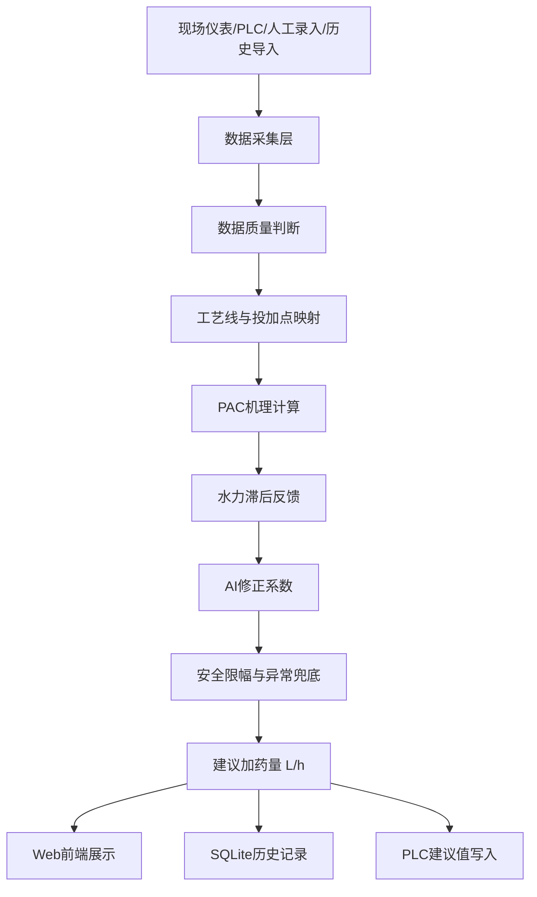

# AI智能PAC除磷加药推荐系统技术方案

## 1. 系统定位

本系统定位为本地部署的 PAC 除磷建议加药系统。系统根据水厂实时数据、延迟数据、人工录入数据、PAC 药剂参数、历史运行数据和模型修正结果，为每个 PAC 投加点输出当前建议加药量：

```text
PAC_Suggest_L_h
```

单位：

```text
L/h
```

系统只负责给出建议值和解释原因，不直接控制加药泵。计量泵启停、频率、手自动切换、故障联锁、低液位保护、管路堵塞保护和最终执行逻辑仍由现场 PLC 或原自控系统负责。

推荐技术路线：

```text
机理公式基础值 + 滞后反馈修正 + AI偏差修正 + 安全限幅 + 人工可调参数
```

不建议让 AI 直接预测最终 L/h 后无约束写入现场。实际工业系统必须保证推荐值可解释、可限幅、可回退、可审计。

## 2. 设计目标

1. 面向真实水厂运行，而不是单纯演示系统。
2. 能适应不同 PAC 浓度、密度、有效成分和药剂批次。
3. 能适应一厂多线、多投加点、部分仪表缺失、数据延迟和人工化验数据。
4. 本地部署，离线可运行，不依赖外部云服务。
5. 优先支持 Windows，架构上保留 Linux 部署能力。
6. PLC 通讯先支持西门子 S7-1500，以太网通讯，后续可扩展。
7. 数据、模型、配置、报警和推荐结果都有历史记录。
8. 现场初期以辅助推荐和影子运行为主，稳定后再写入 PLC 建议值变量。

## 3. 总体架构



建议软件栈：

| 层级 | 推荐方案 | 说明 |
|---|---|---|
| 后端 | Python + FastAPI | 开发效率高，部署简单，接口清晰 |
| 数据库 | SQLite WAL | 单机低频工业数据足够，易备份 |
| 前端 | 原生 HTML/CSS/JS 或轻量 Vue 本地打包 | 不依赖外部 CDN |
| PLC | python-snap7 或 OPC UA | S7-1500 优先考虑 OPC UA，S7 直连作为可选 |
| AI | scikit-learn / LightGBM 可选 | AI 只输出修正系数，不直接接管控制 |
| 部署 | Windows Service / Linux systemd | 先保证 Windows 稳定运行 |

## 4. 工艺对象模型

为了适配不同水厂和多套工艺，系统不能只按“一个进水、一个出水、一个加药点”建模。

推荐层级：

```text
plant
  process_area
    process_line
      dosing_point
        sensor_mapping
        pac_config
        control_config
```

示例：

```text
某污水厂
  预处理共用段
  生化1线
    1#高效池PAC投加点
  生化2线
    2#高效池PAC投加点
  总出水
```

每个投加点独立计算建议值。共享总出水 TP 的场景下，反馈修正可以按流量、历史贡献或人工权重分配到各投加点。

每个投加点至少配置：

| 配置项 | 说明 |
|---|---|
| 投加点名称 | 如 1#高效池PAC |
| 所属工艺线 | 用于多线管理 |
| 流量来源 | 本线流量、总流量按比例分配或人工输入 |
| 磷数据来源 | PO4-P 优先，其次 TP |
| 出水反馈来源 | 本线出水或总出水 |
| PAC 药剂配置 | 密度、Al2O3 含量、有效系数、批次 |
| 控制目标 | 目标 TP、安全目标 TP、出水限值 |
| 推荐上下限 | 最小/最大 L/h |
| 变化率限制 | 单次变化率、单位时间变化率 |
| 数据超时阈值 | 每个仪表独立配置 |
| PLC 标签 | 建议值写入地址，不写控制命令 |

## 5. 数据输入设计

### 5.1 推荐输入

| 数据 | 优先级 | 用途 | 可缺失处理 |
|---|---:|---|---|
| 本线流量 Q | 必需 | 计算磷负荷 | 缺失时保持上次建议或进入保守模式 |
| 投加点前 PO4-P | 高 | 计算实际可沉淀磷 | 缺失时回退 TP |
| 投加点前 TP | 中 | 无 PO4-P 时使用 | 缺失时保守模式 |
| 出水 TP | 中 | 慢反馈修正 | 缺失时暂停反馈 |
| 实际 PAC 加药量 | 中 | 训练和效果评估 | 不影响在线基础推荐 |
| pH | 建议 | 判断 PAC 适用性 | 缺失时只报警不阻断 |
| SS/浊度 | 可选 | AI 特征和混凝状态参考 | 缺失时模型降级 |
| 水温 | 可选 | AI 特征 | 缺失时模型降级 |

### 5.2 数据必须带时间戳

现场在线仪表和化验数据不一定实时，必须对每个数据点保存独立时间戳：

```text
tag_code
value
unit
sample_time
receive_time
quality
source
```

系统不能只用“最近一条记录时间”判断所有数据是否新鲜。流量可能 10 秒更新，出水 TP 可能 1 小时更新，人工化验可能 2 小时更新。

### 5.3 数据状态分类

| 状态 | 判定 | 推荐策略 |
|---|---|---|
| fresh | 未超过该标签 stale_minutes | 正常参与计算 |
| delayed | 超时但仍在可接受窗口 | 可参与慢变量反馈，输出提示 |
| stale | 超过最大可接受时间 | 不参与关键计算 |
| bad | PLC质量位异常、负值、越界 | 不参与计算并报警 |
| manual | 人工录入 | 可参与计算，但标记来源 |
| simulated | 模拟调试 | 不写入生产实时样本 |

## 6. PAC基础加药计算

### 6.1 基本原则

PAC 属于铝盐类除磷药剂。基础推荐值应先从磷负荷和有效铝需求计算，再换算为药液体积流量。

优先使用投加点前 PO4-P：

```text
P_control_mg_L = max(PO4_P_before - TP_target, 0)
```

没有 PO4-P 时使用投加点前 TP：

```text
P_control_mg_L = max(TP_before - TP_target, 0)
```

如果二者都缺失，不应凭 AI 猜测，应进入保守模式。

### 6.2 有效铝需求

铝和磷沉淀的基础化学计量关系：

```text
Al/P mass ratio at 1:1 molar = 27 / 31 = 0.871
```

工程上需要引入 Al/P 摩尔比 R：

```text
Al_need_kg_h = Q_m3_h * P_control_mg_L * 0.871 * R / 1000
```

其中：

| 参数 | 说明 |
|---|---|
| Q_m3_h | 当前投加点对应流量，m3/h |
| P_control_mg_L | 需要控制的磷浓度差，mg/L |
| R | 工程 Al/P 摩尔比，现场调试参数 |

R 不应固定死。建议初始范围：

```text
R = 1.5 到 4.0
```

实际值受出水目标、pH、碱度、SS、混凝沉淀效果、PAC 品质和投加点位置影响。初期可设 2.0 到 3.0，再用现场数据校正。

### 6.3 PAC药液换算

PAC 配置由人工维护：

| 参数 | 示例 | 说明 |
|---|---:|---|
| pac_density_kg_L | 1.20 | 药液密度 |
| al2o3_fraction | 0.10 | Al2O3 质量分数 |
| effective_factor | 0.85 到 1.00 | 药剂有效性或现场修正 |

Al2O3 中铝质量占比：

```text
Al_fraction_in_Al2O3 = 54 / 102 = 0.529
```

每升 PAC 中有效铝质量：

```text
Al_kg_L = pac_density_kg_L * al2o3_fraction * 0.529 * effective_factor
```

基础 PAC 药液量：

```text
PAC_base_L_h = Al_need_kg_h / Al_kg_L
```

合并后：

```text
PAC_base_L_h =
  Q_m3_h * P_control_mg_L * 0.871 * R
  / 1000
  / (pac_density_kg_L * al2o3_fraction * 0.529 * effective_factor)
```

## 7. 滞后反馈修正

出水 TP 通常存在明显水力滞后，尤其在线 TP 取样、消解和分析也会增加延迟。因此出水 TP 不能用于快速 PID，也不能直接把当前出水 TP 当作当前投加效果。

推荐做法：

1. 每个投加点配置 `lag_minutes`。
2. 出水 TP 取 `当前时间 - lag_minutes` 附近的样本。
3. 对反馈样本做移动平均或中位数滤波。
4. 只输出缓慢修正系数。

反馈计算：

```text
tp_error = TP_out_lag_avg - TP_target
K_feedback_raw = 1 + Kp * tp_error
K_feedback = clamp(K_feedback_raw, feedback_min, feedback_max)
```

建议默认：

```text
Kp = 0.15 到 0.40
feedback_min = 0.80
feedback_max = 1.30
feedback_window_minutes = 60 到 180
```

如果出水 TP 缺失、超时或明显异常：

```text
K_feedback = 1.0
```

多投加点共享总出水 TP 时，不建议每个点都完整承担总出水误差。可采用权重：

```text
line_weight = line_flow / total_flow * manual_contribution_factor
K_feedback_i = 1 + line_weight * (K_feedback_global - 1)
```

这样可以避免多条线同时过度加药。

## 8. AI模型设计

### 8.1 AI只做修正

AI 输出修正系数，不直接输出最终 L/h：

```text
PAC_suggest = limit(PAC_base_L_h * K_feedback * K_ai)
```

其中：

```text
0.70 <= K_ai <= 1.30
```

初期无模型或模型不可用：

```text
K_ai = 1.0
```

### 8.2 训练目标

可以从历史数据构造训练目标：

```text
K_actual = PAC_actual_L_h / PAC_base_L_h
```

但不能把所有历史人工加药都当成正确答案。训练样本应过滤：

1. 出水 TP 严重超标期间的样本慎用。
2. 泵故障、低液位、管路堵塞、手动大幅调整期间剔除。
3. PAC 药剂批次或浓度不明的样本剔除。
4. 数据时间无法对齐的样本剔除。
5. 极端负荷冲击样本可保留，但需标记工况。

### 8.3 推荐特征

| 特征 | 说明 |
|---|---|
| Q_m3_h | 当前流量 |
| TP_before / PO4_P_before | 投加前磷 |
| TP_out_lag_avg | 滞后对齐后的出水 TP |
| pH | PAC 效果敏感变量 |
| SS/turbidity | 混凝沉淀状态参考 |
| water_temp | 季节和反应条件 |
| PAC_base_L_h | 机理基础值 |
| PAC_actual_L_h_prev | 上周期实际加药 |
| hour/day/season | 周期性负荷变化 |
| pac_batch_id | 药剂批次 |

### 8.4 模型生命周期

```text
数据采集 -> 样本对齐 -> 训练候选模型 -> 影子运行 -> 人工发布 -> 在线修正
```

发布规则：

1. 新模型默认只是候选模型。
2. 候选模型先做影子运行，只记录预测，不影响推荐。
3. 影子运行效果优于当前策略后，由人工发布。
4. 发布后仍受 `K_ai` 限幅、推荐值限幅和异常回退约束。
5. 模型版本、训练数据时间范围、指标、发布人和发布时间必须记录。

## 9. 安全限幅与异常兜底

### 9.1 推荐值限幅

每个投加点配置：

```text
PAC_min_L_h <= PAC_suggest_L_h <= PAC_max_L_h
```

初期不要使用统一默认值，应根据泵量程和工艺线规模配置。

### 9.2 变化率限制

推荐值变化不宜频繁跳动：

```text
single_step_change_ratio <= 10% 到 20%
max_increase_L_h_per_min
max_decrease_L_h_per_min
```

降低加药通常比增加加药更谨慎，避免短时出水 TP 反弹。

### 9.3 异常策略

| 异常 | 策略 |
|---|---|
| 流量为 0 | 推荐 0 L/h，并标记停水或停线 |
| 流量缺失 | 保持上次有效建议或最低保守值 |
| 磷数据全部缺失 | 保守模式，不用 AI 猜测 |
| PO4-P 缺失 | 回退 TP |
| 出水 TP 缺失 | 暂停反馈修正 |
| pH 超出 PAC 合理范围 | 输出报警，可选择限制增药 |
| PAC 参数缺失 | 禁止计算，要求人工配置 |
| PLC 通讯中断 | 前端报警，继续本地计算和记录 |
| 模型异常 | K_ai 回退 1.0 |

### 9.4 推荐解释

每次推荐必须记录解释字段：

```json
{
  "mode": "normal|conservative|manual|simulation",
  "base_l_h": 35.2,
  "k_feedback": 1.08,
  "k_ai": 0.96,
  "limited_l_h": 36.5,
  "reason": ["PO4-P fresh", "TP feedback lag aligned", "AI model v3 published"]
}
```

## 10. PLC通讯设计

### 10.1 通讯边界

系统可从 PLC 读取现场变量，也可把建议值写入 PLC 的指定 DB 变量。但写入范围只允许：

```text
PAC_Suggest_L_h
PAC_Suggest_Quality
PAC_Suggest_UpdateTime
PAC_Suggest_Mode
```

不允许写入：

```text
泵启停
泵频率
手自动模式
联锁旁路
报警复位
控制参数强制值
```

### 10.2 S7-1500接入建议

S7-1500 可选两种路线：

| 路线 | 优点 | 注意事项 |
|---|---|---|
| OPC UA | 更标准，安全性好，变量语义清晰 | PLC 需启用 OPC UA Server 并配置证书/权限 |
| S7 直连 | 实现直接，适合已有 DB 地址表 | 需确认 PUT/GET、DB优化访问、机型安全设置 |

建议现场优先评估 OPC UA。如果使用 S7 直连，必须由自控工程师提供正式变量表和读写权限确认。

### 10.3 PLC变量映射

建议为每个投加点建立独立映射：

| 字段 | 示例 |
|---|---|
| protocol | opcua / s7 / simulated |
| endpoint | 192.168.1.10 |
| read_tags | Q、TP、PO4-P、pH、PAC_actual |
| write_tag | DB100.DBD0 |
| data_type | REAL |
| scale | 1.0 |
| unit | L/h |
| read_only | false |
| enabled | true |

PLC 写入必须包含测试页和模拟模式。正式写入前至少完成：

1. 离线模拟写入。
2. PLC 测试 DB 写入。
3. 现场只读运行。
4. 写入建议值但 PLC 不采用。
5. PLC 侧人工确认后再参与实际建议显示。

## 11. 数据库设计

SQLite 可以满足单机部署、低频采集和本地趋势需求。建议启用 WAL：

```sql
PRAGMA journal_mode = WAL;
PRAGMA synchronous = NORMAL;
```

核心表：

| 表 | 说明 |
|---|---|
| plants | 水厂信息 |
| process_areas | 工艺区域 |
| process_lines | 工艺线 |
| dosing_points | PAC 投加点 |
| sensor_tags | 仪表标签定义 |
| sensor_samples | 原始采集数据 |
| manual_samples | 人工录入数据 |
| pac_configs | PAC 参数和批次 |
| control_configs | 目标、限幅、反馈和滞后参数 |
| recommendations | 推荐结果 |
| recommendation_explanations | 推荐解释 |
| plc_connections | PLC 连接 |
| plc_tag_mappings | PLC 标签映射 |
| alarms | 报警和事件 |
| model_versions | 模型版本 |
| model_shadow_results | 影子运行结果 |
| audit_logs | 配置变更和人工操作审计 |

数据保留策略：

| 数据 | 建议保留 |
|---|---|
| 原始分钟级数据 | 1 到 3 年 |
| 小时聚合数据 | 3 到 5 年 |
| 推荐结果 | 不少于 3 年 |
| 报警和审计 | 不少于 3 年 |
| 模型版本 | 长期保留 |

## 12. 前端功能设计

前端应简洁、清晰、偏工业系统风格，不做花哨大屏。建议页面：

| 页面 | 主要功能 |
|---|---|
| 总览 | 各投加点当前建议值、状态、关键输入、报警 |
| 工艺配置 | 水厂、工艺线、投加点、反馈关系 |
| 药剂配置 | PAC 密度、Al2O3、有效系数、批次 |
| 数据采集 | 实时数据、人工录入、数据质量 |
| 模拟调试 | 人工输入工况，计算建议值，不写生产数据 |
| 历史趋势 | Q、TP、PO4-P、出水 TP、PAC 建议和实际加药 |
| 模型管理 | 训练、影子运行、发布、回退 |
| PLC 通讯 | 连接状态、变量映射、读写测试 |
| 报警事件 | 数据超时、PLC 中断、参数缺失、模型异常 |
| 系统设置 | 数据保留、备份、用户权限 |

趋势页面必须支持按投加点筛选，并能同时查看：

```text
流量
投加前TP或PO4-P
出水TP
PAC建议L/h
PAC实际L/h
推荐模式
```

## 13. 模拟调试设计

系统必须支持不依赖现场实时数据的调试。

模拟调试分两类：

| 模式 | 说明 |
|---|---|
| 单点模拟 | 人工输入 Q、TP、PO4-P、PAC 参数，立即计算 |
| 场景回放 | 导入历史 CSV，按时间顺序重放并生成推荐 |

模拟结果默认不写入生产实时表，但可以写入单独的 simulation_runs 表，便于调试对比。

模拟页必须显示：

1. 基础公式计算值。
2. 反馈修正系数。
3. AI 修正系数。
4. 限幅前后对比。
5. 进入保守模式的原因。

## 14. 部署方案

### 14.1 Windows优先

推荐目录：

```text
C:\AI_PAC\
  app\
  static\
  data\
  models\
  logs\
  config\
  backup\
```

启动方式：

1. 开发调试：命令行启动 Uvicorn。
2. 现场运行：注册为 Windows Service。
3. 数据备份：定时复制 SQLite 数据库和模型目录。

### 14.2 Linux适配

Linux 使用 systemd 管理服务：

```text
/opt/ai_pac/
/var/lib/ai_pac/
/var/log/ai_pac/
```

代码层面避免 Windows 专用路径和编码假设。

### 14.3 资源建议

一般水厂单机部署建议：

| 规模 | CPU | 内存 | 磁盘 |
|---|---|---|---|
| 1 到 5 个投加点 | 2 核 | 4 GB | 64 GB SSD |
| 5 到 20 个投加点 | 4 核 | 8 GB | 128 GB SSD |

SQLite、FastAPI 和轻量模型对资源要求不高。真正影响资源的是历史数据保留周期、趋势查询范围和模型训练频率。

## 15. 开发阶段划分

### 阶段1：工程MVP

目标：能本地运行，能手动输入，能计算建议 L/h。

范围：

1. FastAPI 后端。
2. SQLite 数据库。
3. 投加点配置。
4. PAC 药剂配置。
5. 机理公式计算。
6. 手动录入和模拟调试。
7. 简洁前端。

### 阶段2：数据采集和历史趋势

目标：接入 PLC 或模拟采集，形成历史数据。

范围：

1. S7-1500 或 OPC UA 读取。
2. 每个标签独立时间戳和质量位。
3. 趋势查询。
4. 报警事件。
5. 数据导入导出。

### 阶段3：反馈和多线适配

目标：适配真实工艺滞后和多投加点。

范围：

1. 水力滞后配置。
2. 出水 TP 移动平均反馈。
3. 多线共享出水反馈分配。
4. 多投加点独立限幅。

### 阶段4：AI影子运行

目标：模型只观察和评估，不影响生产推荐。

范围：

1. 历史样本对齐。
2. 训练候选模型。
3. 影子运行结果记录。
4. 模型指标页面。

### 阶段5：AI辅助推荐

目标：人工发布模型后参与推荐。

范围：

1. 发布/回退机制。
2. K_ai 限幅。
3. 模型异常回退。
4. 推荐解释。

### 阶段6：PLC建议值写入

目标：把建议值写入 PLC 指定变量，但不控制泵。

范围：

1. 写入测试。
2. 写入质量位。
3. 写入时间戳。
4. 通讯中断报警。
5. PLC 侧确认采用逻辑。

## 16. 验收测试

### 16.1 算法验收

1. 已知 Q、TP、PAC 参数时，公式结果可手算复核。
2. PO4-P 存在时优先使用 PO4-P。
3. PO4-P 缺失时回退 TP。
4. 磷数据全部缺失时进入保守模式。
5. 出水 TP 超时时暂停反馈。
6. 推荐值不超过上下限。
7. 推荐值变化率受限制。
8. AI 异常时自动回退。

### 16.2 工艺验收

1. 单投加点水厂能正常推荐。
2. 多工艺线水厂能分别推荐。
3. 共享总出水 TP 时不会所有投加点同时过度增药。
4. 1 到 2 小时化验数据延迟时，系统能标记延迟并按规则使用。
5. 缺少 PO4-P 或二沉池后 TP 仪表时，系统能按降级策略运行。

### 16.3 PLC验收

1. PLC 断开时系统不崩溃。
2. 读变量失败时有清晰报警。
3. 写入只发生在允许的建议值变量。
4. 写入值、质量位、更新时间一致。
5. PLC 侧不因本系统异常而影响原有控制。

### 16.4 部署验收

1. 断网环境可启动。
2. 重启后配置和历史数据保留。
3. 数据库可备份和恢复。
4. 日志可追踪异常。
5. Windows 开机后服务可自动启动。

## 17. 关键工程注意事项

1. PAC 参数必须人工可配置，不能写死。
2. 出水 TP 必须考虑水力滞后和仪表分析周期。
3. AI 不能绕过机理公式和安全限幅。
4. 缺仪表是常态，系统要有明确降级路径。
5. 多投加点不能简单共用一个总出水误差直接放大。
6. PLC 写入必须有边界，只写建议，不写控制。
7. 所有推荐值必须可解释，方便现场人员接受和复核。
8. 初期目标应是稳定达标和减少人工波动，不应承诺固定节药率。

## 18. 参考依据

1. WEF 磷去除资料中给出铝盐除磷的基础化学计量关系，1:1 摩尔比下约为 0.87 g Al/g P。
   链接：https://www.wef.org/globalassets/assets-wef/2-resources/online-education/webcasts/presentation-handouts/PresentationHandoutsPhosphorusRemoval.pdf
2. Minnesota Pollution Control Agency 的磷处理资料指出，铝盐除磷效率受 pH 影响，化学加药会增加污泥量。
   链接：https://www.pca.state.mn.us/sites/default/files/wq-wwtp9-02.pdf
3. python-snap7 文档提供 S7-1200/S7-1500 连接说明，可作为 S7 直连方案参考。
   链接：https://python-snap7.readthedocs.io/en/latest/connecting.html
4. SQLite 官方 WAL 文档说明 WAL 模式下读写并发能力更适合本地历史数据系统。
   链接：https://sqlite.org/wal.html

## 19. 一句话总结

```text
本系统不是让 AI 接管 PAC 加药泵，而是在 PLC 安全控制之外，用机理公式保证基础合理，用滞后反馈和 AI 修正适配现场差异，最终为每个投加点输出可解释、可限幅、可回退的 PAC 建议加药量 L/h。
```
